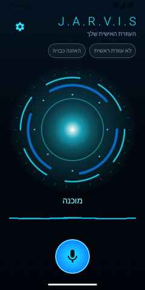
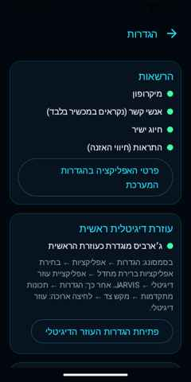

# JARVIS AI — עוזרת קולית לאנדרואיד (Galaxy S23 Ultra · Android 16)

אפליקציית Android מלאה (Kotlin + Jetpack Compose) שמחליפה את Gemini כעוזרת הדיגיטלית הראשית:
זיהוי פקודות בעברית, חיוג לאנשי קשר עם הגנה מפני חיוג שגוי, מילת הפעלה מקומית, קול עברי ותמיכה בנהיגה.
הגרסה הראשונה **עובדת בלי אינטרנט ובלי שרת** — לאפליקציה אין בכלל הרשאת `INTERNET`.

> זה פרויקט נפרד מאפליקציית הטאבלט (`android/`). הוא נמצא בתיקייה `phone/`.

<p>




</p>

---

## 1. התקנה מהירה (APK)

1. GitHub → Actions → **JARVIS Assistant APK** → הריצה האחרונה (ירוקה) → Artifacts → `jarvis-assistant-apk`.
   בתוך ה-ZIP: `jarvis-assistant.apk`.
   *(לגרסה קבועה: דחיפת תגית `assistant-v1.0.0` יוצרת Release עם ה-APK.)*
2. מעבירים את הקובץ לטלפון ופותחים אותו. Samsung תבקש לאשר "התקנת אפליקציות לא מוכרות" עבור אפליקציית הקבצים/הדפדפן — לאשר.
3. אם Play Protect מזהיר — "פרטים נוספים" ← "התקן בכל זאת" (האפליקציה חתומה במפתח פרטי שלך ואינה מ-Play).
4. פותחים את JARVIS ← **אישור הרשאות**: מיקרופון, אנשי קשר, טלפון, התראות.
5. **הגדרות JARVIS ← "ביטול אופטימיזציית סוללה"** — חובה בסמסונג אם רוצים מילת הפעלה.
   בנוסף: הגדרות מערכת ← אפליקציות ← JARVIS ← סוללה ← **ללא הגבלה**.
   ומומלץ: הגדרות ← טיפול בסוללה ובמכשיר ← סוללה ← הגבלות שימוש ברקע ← לוודא ש-JARVIS **לא** ברשימת "אפליקציות במצב שינה".

עדכון גרסה: מתקינים APK חדש מעל הקיים (אותו מפתח חתימה → ההגדרות נשמרות).

## 2. הגדרת JARVIS כעוזרת הדיגיטלית הראשית (במקום Gemini)

1. בתוך JARVIS: הגדרות ← **"פתיחת הגדרות העוזר הדיגיטלי"**,
   או ידנית: **הגדרות ← אפליקציות ← בחירת אפליקציות ברירת מחדל ← אפליקציית עוזר דיגיטלי ← אפליקציית עוזר דיגיטלי ← JARVIS**.
2. אנדרואיד יציג אזהרה שהעוזרת תוכל לקרוא מידע מהמסך — זה ניסוח סטנדרטי של המערכת. JARVIS **לא** קוראת את תוכן המסך (לא ממומש `onHandleAssist`).
3. מקש הצד: **הגדרות ← תכונות מתקדמות ← מקש צד ← לחיצה ארוכה ← עוזר דיגיטלי**.
4. מחוות: עם ניווט במחוות — החלקה מפינה תחתונה לכיוון מרכז המסך מפעילה את העוזרת.
5. במסך JARVIS יופיע הסימון **"עוזרת ראשית ✓"**.

שימו לב: בחירת עוזרת דיגיטלית **לא** נותנת אוטומטית האזנה רציפה או מילת הפעלה (ראו סעיף 5).
היא גם הופכת את JARVIS ל"שירות הקלט הקולי" ברירת המחדל — לכן JARVIS כוללת `RecognitionService`
שמעביר את הבקשות של אפליקציות אחרות למנוע הזיהוי האמיתי של Google/Samsung, כדי שלא ישבר שום דבר.

## 3. שימוש

| אומרים | מה קורה |
|---|---|
| "היי ג׳ארביס, תתקשרי לשלי" | "בשמחה, מחייגת לשלי כהן." ← שיחה יוצאת |
| "ג׳ארביס, תחייגי לבר" | חיוג לבר (אם יש בדיוק איש קשר אחד כזה) |
| "ג׳ארביס, תתקשרי לגל לנייד" | יש שני "גל"? — "מצאתי כמה אנשי קשר: גל אברהם וגל מזרחי. למי להתקשר?" ← "גל מזרחי" / "השני" |
| "ג׳ארביס, חייגי למספר 0501234567" | "לחייג למספר אפס חמש אפס, אחת שתיים שלוש…?" ← "כן" |
| "מה השעה?" | "השעה שתים עשרה וחצי." |
| "מה התאריך?" | "היום יום רביעי, חמישה עשר באוקטובר." |
| "ג׳ארביס, תפסיקי להקשיב" / "לכי לישון" | מכבה את ההאזנה למילת ההפעלה |
| "ביטול" / "לא" | מבטל שאלה פתוחה |

כללי בטיחות בחיוג (ממומשים ב-`core/…/DialogManager.kt` ונבדקים ב-unit tests):
* חיוג מיידי **רק** כשיש התאמה מדויקת ויחידה לשם (שם מלא / שם פרטי / כינוי).
* כמה אנשי קשר מתאימים → שאלה "למי?".
* התאמה חלקית או פונטית (שגיאת תמלול, "שלו" במקום "שלי", שם באנגלית) → "לא בטוחה ששמעתי נכון. להתקשר לשלי כהן?" — חיוג רק אחרי "כן".
* כמה מספרים לאותו איש קשר → מספר ברירת מחדל (אם הוגדר) או שאלה "נייד או בית?". מספרים כפולים (+972/05…) מאוחדים.
* מספר שהוכתב ספרה-ספרה מוקרא לאישור (ניתן לכבות).
* אחרי שתי תשובות לא מובנות — ביטול, בלי חיוג.
* אופציה: "לשאול לפני כל שיחה".

המערכת רק **מחייגת** (`TelecomManager.placeCall`); את השיחה מנהל המשתמש בעצמו.
אם הרשאת חיוג לא ניתנה (או כובה "חיוג ישיר") — נפתח החייגן עם המספר (`ACTION_DIAL`).

## 4. ארכיטקטורה

```
phone/
├── core/       Kotlin/JVM טהור — נבדק ביחידות בלי אנדרואיד
│   ├── text/HebrewText        נרמול עברית, גרש, אותיות סופיות, מפתח פונטי, ספרות מדוברות
│   ├── nlu/CommandParser      זיהוי פקודות בעברית (חוקים, לא ענן), מילת ההפעלה, תשובות כן/לא/ראשון/נייד
│   ├── contacts/ContactMatcher התאמת שם מדובר לאנשי קשר: מדויק / חלקי / פונטי + מדיניות ודאות
│   ├── dialog/DialogManager   מכונת מצבים: הבהרות, אישורים, בחירת מספר, ניסוחים בלשון נקבה
│   ├── speech/HebrewSpeech    שעה ותאריך בעברית מדוברת
│   └── skills/Skill           נקודת הרחבה ליכולות עתידיות
├── wakeword/   ספריית Android: openWakeWord על ONNX Runtime (מקומי), לולאת AudioRecord
└── app/        אפליקציית Android (MVVM + Compose)
    ├── voice/JarvisVoiceInteractionService   העוזרת הדיגיטלית (VoiceInteractionService)
    ├── voice/JarvisSessionService + JarvisSession   חלונית העוזרת (גם על מסך נעול)
    ├── voice/JarvisRecognitionService        חובה לכל עוזרת; מעביר למנוע האמיתי
    ├── voice/stt/SpeechInput                 SpeechRecognizer: on-device ← מנוע מערכת מפורש
    ├── voice/tts/JarvisTts                   TextToSpeech בעברית, ערוץ Assistant, ducking
    ├── service/ListeningService              Foreground Service מסוג microphone למילת ההפעלה
    ├── engine/AssistantEngine                האזנה → הבנה → דיבור → פעולה → האזנה חוזרת
    ├── contacts/AndroidContactSource         ContactsContract (טלפונים + כינויים)
    ├── telephony/CallPlacer                  TelecomManager.placeCall / ACTION_DIAL
    └── ui/                                   מסך ראשי, כדור אנרגיה, גלי קול, הגדרות, חלונית עוזרת
```

הוספת יכולת עתידית (Waze, מוזיקה, Home Assistant, Webhook, ChatGPT, שרת Node.js):
מוסיפים `Skill` ב-`core` (או `Command` חדש ב-`CommandParser`) ומעבירים אותו ל-`AssistantEngine(skills = …)`.
יכולות שדורשות רשת יחייבו להוסיף הרשאת `INTERNET` והסכמה מפורשת, ומפתחות API יישמרו ב-Android Keystore — לא בקוד.

## 5. מגבלות Android 16 / One UI — מה אפשרי ומה לא

### מילת הפעלה כשהמסך כבוי
* **ה-API הרשמי של Hotword חסום לאפליקציות צד-שלישי.** `AlwaysOnHotwordDetector` (DSP) דורש הרשמת keyphrase
  דרך אפליקציית מערכת (`MANAGE_VOICE_KEYPHRASES`), ו-`HotwordDetectionService` / `createHotwordDetector`
  הם `@SystemApi` עם `MANAGE_HOTWORD_DETECTION` (privileged). Gemini/Bixby משתמשים בהם כי הם מותקנים מראש.
* **מה JARVIS עושה בפועל:** Foreground Service מסוג `microphone` עם התראה קבועה ונקודה ירוקה, שמריץ מודל מקומי
  (openWakeWord) על המעבד. השירות ממשיך גם כשהמסך כבוי והטלפון נעול.
* **כללי הפעלה של אנדרואיד 14–16:** אסור להתחיל שירות מיקרופון מהרקע, חוץ מחריגים — ביניהם
  *"השירות מופעל מאפליקציה שמספקת את ה-VoiceInteractionService"*. לכן כש-JARVIS היא העוזרת הראשית,
  `onReady()` מחדש את ההאזנה גם אחרי אתחול. אם אנדרואיד מסרב — מופיעה התראה "הקישו כדי להפעיל שוב" (לחיצה על התראה היא חריג מותר).
* **אנדרואיד 15+ אוסר להתחיל שירות מיקרופון מ-`BOOT_COMPLETED`** — לכן ה-BootReceiver רק מציג את התראת "הקישו כדי להפעיל".
* **צריכת סוללה:** המודל רץ כל 80ms על ה-CPU. צפו לצריכה מורגשת (לא נמדד עדיין על המכשיר). המתג מאפשר לכבות.
* **אחרי מילת ההפעלה** המיקרופון עובר למנוע זיהוי הדיבור, וזה לוקח שבריר שנייה — אומרים "היי ג׳ארביס", מחכים לצפצוף, ואז הפקודה.

### מודל מילת ההפעלה — עברית
* המודל המצורף `hey_jarvis_v0.1` (openWakeWord, רישיון CC BY-NC-SA 4.0 — שימוש אישי) **אומן על דיבור אנגלי**.
* בדיקה שנעשתה כאן: על דיבור סינתטי (espeak-ng) — "hey jarvis" באנגלית: ציון **0.99** (זיהוי);
  "היי ג׳ארביס" בקול עברי סינתטי: **0.003** (אין זיהוי). דיבור סינתטי אינו הגייה אנושית, אבל ברור
  ש**אין להציג את המודל האנגלי כפתרון מוכח לעברית**. הוא כלול כמודל ניסיוני ("hey jarvis" בהגייה אנגלית כן צפוי לעבוד).
* **לא מצאתי מודל קיים ל"ג׳ארביס" בהגייה עברית.** תהליך מוצע ליצירת מודל מותאם — סעיף 9.
* חלופות אמינות שעובדות היום: מקש הצד (לחיצה ארוכה), מחוות פינה, כפתור במסך, וגם ממסך נעול.

### זיהוי דיבור בעברית ללא אינטרנט
* **Vosk** — אין מודל עברי רשמי ברשימת המודלים. **sherpa-onnx** — אין מודל streaming עברי איכותי; Whisper רב-לשוני
  (tiny/base) חלש בעברית, ו-Whisper גדול (למשל ivrit-ai) כבד מדי לזמן אמת בטלפון. לכן לא שולב מנוע STT משובץ.
* **הפתרון:** `SpeechRecognizer.createOnDeviceSpeechRecognizer` (Android 12+) — אם קיים במכשיר שירות on-device
  עם עברית מותקנת, הזיהוי מקומי לחלוטין. האפליקציה **בודקת בפועל** (`checkRecognitionSupport`, Android 13+) אם עברית
  מותקנת/ניתנת להורדה, ומציעה הורדה (`triggerModelDownload`). מסך ההגדרות מציג את התוצאה.
* אם אין מנוע on-device עם עברית — שימוש מפורש במנוע של Google (`EXTRA_PREFER_OFFLINE`), שיעבוד בלי רשת **רק**
  אם הורדה חבילת העברית האופליין שלו; אחרת הוא ישתמש בשרתי Google. המסך הראשי מציין איזה מנוע שימש.
* JARVIS אף פעם לא משתמשת ב"מנוע ברירת המחדל" — כי כשהיא העוזרת הראשית, ברירת המחדל היא היא עצמה.

### קול נשי בעברית
* משתמשים ב-TTS של המכשיר (Google Speech Services / Samsung TTS). האפליקציה מציגה את כל הקולות העבריים,
  מסמנת אילו דורשים רשת/לא מותקנים, מאפשרת השמעה ובחירה, ופותחת את מסך הורדת הקולות.
* אנדרואיד **לא חושף מגדר** של קול — בוחרים לפי השמעה. בהיעדר קול נשי מקומי איכותי: קול מקומי אחר (תמיד עובד),
  ובהמשך אפשר להוסיף TTS בענן (OpenAI/Azure) כ-Skill אופציונלי.
* ניסוחי התשובות כתובים בלשון נקבה ("מחייגת", "מקשיבה").

### Android Auto
* **אין API רשמי** שמאפשר לאפליקציה צד-שלישי להחליף את העוזרת של Android Auto או לקבל את מיקרופון הרכב.
  כפתור הקול ברכב ו-"Hey Google" ברכב ימשיכו להפעיל את Google Assistant/Gemini.
* ספריית Car App מאפשרת רק קטגוריות מוגדרות (ניווט, מדיה, הודעות, נקודות עניין…) — אין קטגוריית "עוזרת".
* מה כן ממומש:
  * זיהוי חיבור Android Auto (`CarConnection`) — מוצג "מצב נהיגה".
  * החיוג נעשה דרך `TelecomManager` — שיחה ממסך נעול עוברת לדיבורית הרכב כמו כל שיחה רגילה.
  * הדיבור יוצא בערוץ `USAGE_ASSISTANT` עם ducking — אמור להתנגן ברמקולי הרכב ולהנמיך מוזיקה.
  * הפעלה ללא נגיעה: מילת ההפעלה (מיקרופון **הטלפון**, לא של הרכב) או לחיצה ארוכה על מקש הצד.
* חלופה מעשית בטוחה: להשאיר את "היי ג׳ארביס" פעיל בזמן נהיגה, עם הטלפון קרוב לנהג; או להשתמש בעוזרת של Android Auto לחיוג
  ("Hey Google, תתקשר ל…") כשהמודל המותאם עוד לא מוכן.

## 6. מה נבדק בפועל ומה טרם אומת

ראו טבלה מלאה ב-[`VERIFICATION.md`](VERIFICATION.md).

## 7. פרטיות ואבטחה
* אין הרשאת `INTERNET` — אנשי קשר, הקלטות ופקודות לא יכולים לצאת מהמכשיר דרך JARVIS.
* אין שמירת קול: השמע של מילת ההפעלה נמצא בזיכרון (חלון של ~2 שניות) בלבד; אין קבצים, אין לוגים של שמע.
* פקודות שנאמרו לא נרשמות ללוג בגרסת release (רק ב-debug, לבדיקות האמולטור).
* מתג "האזנה" במסך הראשי + פקודת "תפסיקי להקשיב" + כפתור "הפסקת האזנה" בהתראה.
* חיווי ברור: התראה קבועה כשמיקרופון ההאזנה פעיל, נקודה אדומה במסך, ונקודת הפרטיות הירוקה של אנדרואיד.
* אין גיבוי לענן של נתוני האפליקציה (`allowBackup=false`, data extraction rules).
* פעולות debug (הזרקת אנשי קשר/פקודות) קיימות רק ב-APK של debug ומוגנות בהרשאת `DUMP` (רק adb).
* מפתח החתימה `jarvis-assistant.jks` נשמר במאגר הפרטי (כמו בתחנה) כדי שכל build יוכל לעדכן את האפליקציה המותקנת.
  אם המאגר יהיה ציבורי — להעביר את הסיסמה ל-GitHub Secret ולהחליף מפתח.

## 8. בנייה

```bash
cd phone
./gradlew :core:test            # בדיקות יחידה (עברית, התאמת אנשי קשר, דיאלוג)
./gradlew :app:assembleRelease  # APK (חתום אם JARVIS_ASSISTANT_KEYSTORE מוגדר, אחרת מפתח debug)
```
Android Studio: File ← Open ← `phone/`. דרישות: JDK 17, Android SDK 36.
CI: `.github/workflows/assistant-apk.yml` — בדיקות, APK, ובדיקת עשן על אמולטור Android 16.

גרסאות: AGP 8.12, Kotlin 2.2, Compose BOM 2025.06, ONNX Runtime 1.22, minSdk 31, targetSdk 36.

## 9. יצירת מודל מילת הפעלה "ג׳ארביס" בעברית

1. **איסוף דוגמאות חיוביות:** 50–200 הקלטות של **הקול שלך** אומר "ג׳ארביס" ו"היי ג׳ארביס" (מרחקים שונים, רכב, רעש, לחישה),
   16kHz מונו. בנוסף אלפי דוגמאות סינתטיות מ-TTS עברי (למשל Azure `he-IL-HilaNeural`/`AvriNeural`, Google `he-IL` WaveNet)
   עם וריאציות קצב/גובה/SSML — ספריית ההדרכה של openWakeWord תומכת בהוספת קבצים חיצוניים.
2. **שליליות:** דיבור עברי כללי (Common Voice עברית, ivrit.ai), מילים דומות ("ג׳ני", "גרביים", "חרבות", "ארביס"),
   מוזיקה ורעשי רכב; בנוסף ה-features השליליים המחושבים מראש של openWakeWord.
3. **אימון:** מחברת `automatic_model_training` של openWakeWord (Colab), ייצוא ל-ONNX.
4. **בדיקה מקומית:** `python3 phone/tools/wakeword/score_wav.py --model my_jarvis_he.onnx הקלטות/*.wav`
   — אותו pipeline כמו באפליקציה. מטרה: ≥95% זיהוי על הקלטות חיוביות, ופחות מהפעלת-שווא אחת ל-5–10 שעות דיבור/רדיו.
5. **ייבוא לטלפון:** הגדרות JARVIS ← מילת הפעלה ← "ייבוא מודל ‎.onnx" ← כיוון רגישות עם "ציון זיהוי חי".
